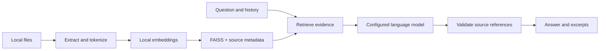

<div align="center">

# eve-ah

**Your documents. Traceable answers.**

A self-hosted AI assistant that answers questions from your documents, with source citations and your choice of model provider.

[Quick start](#quick-start) · [Configuration](docs/configuration.md) · [Evaluation](docs/evaluation.md) · [Deployment](docs/deployment.md)

</div>

## What it does

- Reads local **TXT, Markdown, text-based PDF, and DOCX** files.
- Builds a local semantic search index using SentenceTransformers and FAISS.
- Answers with inspectable source excerpts and PDF page references.
- Supports **Gemini and OpenAI** through small, separate HTTP adapters.
- Includes a responsive browser chat interface and a FastAPI HTTP API.
- Updates the index for added, edited, or deleted documents, reusing unchanged embeddings.
- Keeps the previous index active when ingestion fails.
- Provides a retrieval evaluation command, deterministic tests, and CI.

This is retrieval-augmented generation (RAG), not model fine-tuning. Version 0.1 is intended for local, single-operator use with small corpora. It is not a hosted multi-tenant service.

## Quick start

Requires Python **3.11–3.13**. Python 3.12 is recommended. First ingestion downloads an embedding model; generation requires a provider API key and internet access.

```bash
git clone https://github.com/TonyPushkal/eve-ah.git
cd eve-ah
python3.12 -m venv .venv
source .venv/bin/activate
python -m pip install -e '.[dev]'
cp .env.example .env
cp bot.example.yaml bot.yaml
mkdir -p data
cp examples/shop/*.md data/
```

On Windows, activate with `.venv\Scripts\Activate.ps1`. If your `python` already selects a supported version, use it instead of `python3.12`.

Set `EVE_API_KEY` in `.env` and select a model available to your provider account:

```dotenv
EVE_PROVIDER=gemini
EVE_MODEL=gemini-2.5-flash
EVE_API_KEY=your-key-here
```

For OpenAI, set `EVE_PROVIDER=openai`, `EVE_MODEL=gpt-4.1-mini`, and your OpenAI key. Model names are examples, not a promise of account availability.

```bash
eve-ah check
eve-ah ingest
eve-ah serve
```

Open **http://127.0.0.1:8000** and ask “How long do I have to return an item?” The included shop dataset is fictional.

Add your own files to `data/`, run `eve-ah ingest`, and **restart the server** after changes. The server pins an immutable index generation. Ingestion needs no generation API key.

### Docker

After creating `.env` and `bot.yaml`, and placing documents in `data/`:

```bash
docker compose build
docker compose run --rm app eve-ah ingest
docker compose up
```

Open the same localhost URL. Index and model caches use named volumes. See [deployment notes](docs/deployment.md) for updates, storage retention, and public hosting requirements.

## How it works



In **knowledge mode** (default), unmatched questions return a helpful topic redirect without calling the generation provider. The intent router also handles greetings, action requests, and requests for live or personal data immediately; eve-ah explains its limit and points back to configured topics. Normal policy questions still use retrieval and source-backed generation. Answers without valid references abstain. Citation validation checks that a referenced passage exists; it cannot prove every generated claim is true. Review the excerpts for important decisions.

Optional **general mode** permits explicitly labeled general-knowledge answers when retrieval finds no evidence. Neither mode executes tools or document instructions.

Follow-up retrieval incorporates the last two user questions. This is deliberately simple conversation context, not a sophisticated query-rewriting system. Clear the conversation when switching topics.

The browser welcome screen renders configured topics and suggested questions as clickable prompts. The evidence panel appears only for source-backed answers, and recovery responses offer next questions without exposing retrieval terminology.

## API

```bash
curl http://127.0.0.1:8000/api/chat \
  -H 'Content-Type: application/json' \
  -d '{"message":"What is the return policy?","history":[]}'
```

The response includes `answer`, `sources` (`id`, `name`, `text`, `page`, `score`), `grounding`, and `response_type`. `grounding` remains the stable evidence axis (`documents`, `general`, `workspace`, `clarification`, or `insufficient`); `response_type` describes the conversational behavior, such as `action`, `live_data`, `small_talk`, or `out_of_scope`. Existing clients can continue using `grounding`, while richer interfaces can use `response_type` for labels and recovery prompts. `/openapi.json` contains the exact API schema. `/health` checks liveness; `/ready` returns 503 until the server has a valid configuration and nonempty index.

## Privacy

Your documents and embeddings are stored locally. **Questions, bounded conversation history, and retrieved passages are sent to the selected generation provider.** This is not a fully offline assistant. API keys stay on the server. Browser history stays in tab memory and clears on reload. `.env`, personal bot settings, documents, indexes, and logs are ignored by Git.

## Development

```bash
python -m pytest -q
ruff check .
ruff format --check .
python -m build
```

Tests use deterministic embedding/provider substitutes and need no paid API calls or model downloads. Real retrieval evaluation is separate:

```bash
eve-ah evaluate examples/shop/evaluation.json
```

Use a shop-only index for that dataset. See [evaluation methodology](docs/evaluation.md); do not treat test pass counts as evidence of answer accuracy.

## Current boundaries

- No OCR, website crawling, audio/video ingestion, authentication, or web uploads.
- Local English embeddings by default; other languages need a suitable model and evaluation.
- Plain-text answers with citations; Markdown is displayed literally for predictable, safe rendering.
- No automatic index refresh; restart after ingestion.
- Historical index generations remain on disk; deleting a source from the current index is not a secure purge.
- No published accuracy, concurrency, or latency claims until measurements are reproducible.

## License

[MIT](LICENSE). Example documents are fictional and included under the same license.
