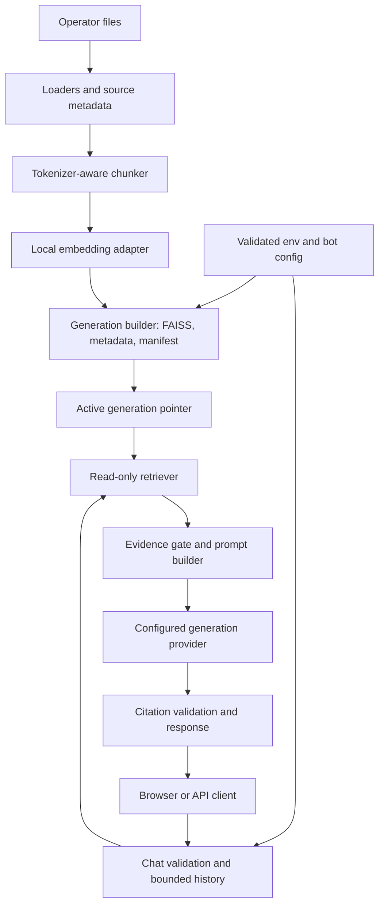
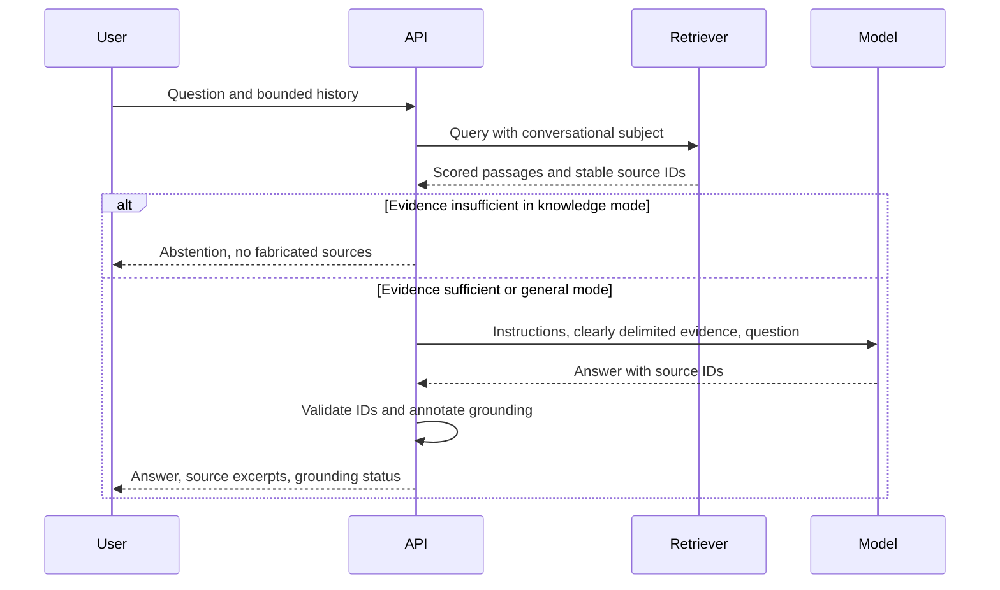

# eve-ah - Plan

## Goal Capsule

Enable someone to clone a public repository, supply their own API key and documents, and run a useful chatbot without changing application code.

Build an independently implemented open-source project, provisionally named `eve-ah`. This document specifies the product and implementation plan; implementation and publication are subsequent milestones.

Completion means the documented setup works from a fresh clone and two unrelated example datasets produce correctly sourced answers without brand-specific behavior.

---
## Product Contract

### Summary

Build a self-hosted document-question-answering bot with a browser chat interface and HTTP API. Separate knowledge, bot behavior, model configuration, and application code so the same project can serve product documentation, internal handbooks, educational material, or FAQs.

### Problem Frame

People need a practical way to ask questions of their own documents without hard-coding a domain into application code. A useful knowledge assistant must keep its index current, show where answers come from, and make unsupported answers distinguishable from documented facts.

“Training data” here means a searchable knowledge base. The system retrieves relevant passages and supplies them to an existing language model; it does not fine-tune that model. Versatility means configuring different knowledge domains. Reliable arithmetic over large tables, live database queries, transactional actions, and arbitrary agent workflows require separate capabilities.

### Requirements

**Setup and customization**

- R1. A fresh clone can run with a documented Python setup or Docker, without organization-specific infrastructure or credentials.
- R2. Operators supply provider credentials through `.env`; committed examples contain placeholders only.
- R3. Operators select a provider/model and configure the bot name, instructions, welcome message, and answer policy without modifying Python.
- R4. Operators supply multiple local TXT, Markdown, text-based PDF, or DOCX files in a configured data directory.

**Knowledge and answers**

- R5. Ingestion reports accepted, skipped, and failed files; unsupported or image-only documents receive an actionable explanation.
- R6. Reindexing reflects file additions, edits, and deletions, and detects incompatible embedding or chunking settings.
- R7. Knowledge mode answers from retrieved material with source references and explicitly abstains when evidence is insufficient.
- R8. Optional general mode allows general-knowledge answers but identifies them as not grounded in supplied documents.
- R9. A browser chat interface supports follow-up questions and clearing the conversation; the same chat capability is available over HTTP.

**Reliability and distribution**

- R10. Invalid configuration, unavailable indexes, and provider failures produce useful, structured errors without exposing credentials or private paths.
- R11. Private documents, indexes, logs, and credentials are excluded from Git and release images by default.
- R12. The repository includes synthetic examples, tests, installation instructions, configuration documentation, and contribution guidance.

### Assumed initial scope

These are proposed defaults, not previously confirmed user choices: one operator-controlled knowledge base per deployment; local-first use; English retrieval evaluated first; Gemini as the first provider and a second adapter proving the provider boundary; a simple browser UI served by the API; no public upload/admin endpoint.

Start with document Q&A. Defer website crawling, OCR, audio/video ingestion, hosted multi-tenant accounts, persistent server-side conversations, remote vector databases, hybrid search/reranking, tool execution, and database connectors. Keep adapters narrow enough that these can be added later without placing speculative infrastructure in version one.

### Acceptance examples

- AE1. Given a synthetic shop policy, asking about its return window returns the stated window with its source; asking an uncovered policy question produces an abstention. Covers R4, R7.
- AE2. Given a different installation using course notes, changing only data and bot configuration produces course-specific behavior without unrelated branding or domain assumptions. Covers R1–R4.
- AE3. Given an indexed policy edited from 14 to 30 days, ingestion and reload make the new value searchable; deleting the file removes its evidence. Covers R6.
- AE4. Given the follow-up “Does that apply internationally?”, retrieval uses bounded prior conversation to resolve the subject without treating a previous generated answer as documentary evidence. Covers R7, R9.

---
## Planning Contract

### Design rationale

Keep domain knowledge, persona configuration, retrieval, and generation independently replaceable. Use explicit ingestion so updates and failures can be inspected before a new index becomes active.

Chunking must respect the selected embedding tokenizer's actual input limits. The default candidate model truncates above 256 word pieces, so fixed large word-count chunks can silently lose searchable content. [Model card](https://huggingface.co/sentence-transformers/all-MiniLM-L6-v2).

All implementation, examples, and public documentation will be authored for this project. Use synthetic or appropriately licensed public data and retain required third-party notices. Private repository history, internal architecture reports, employer-specific assets, and credentials are not public project inputs.

### Key technical decisions

- KTD1. Use Python/FastAPI and a small explicit RAG pipeline. An explicit pipeline keeps retrieval and generation easy to test; an agent framework is unnecessary for this bounded workflow.
- KTD2. Keep `.env` for deployment settings and secrets, `bot.yaml` for persona/retrieval policy, and `data/` for operator documents. Validate both configuration sources at startup with documented precedence: environment overrides deployment defaults; bot settings belong to YAML. Covers R2–R4.
- KTD3. Keep local SentenceTransformers embeddings and FAISS for the initial single-instance design. Use normalized embeddings with inner-product search, storing metadata in JSON rather than pickle. Keep generation-provider and embedding-model settings independent. Covers R6–R7.
- KTD4. Separate ingestion from serving. A CLI builds a complete immutable generation in a temporary directory, validates it, then atomically changes the active generation pointer. Serving pins one generation until restart; the initial workflow explicitly restarts after successful ingestion. A supported-file extraction failure aborts activation and leaves the previous generation intact. An intentionally empty input folder activates an empty generation, removes all old evidence, and makes knowledge-mode chat and readiness return 503 with a no-documents explanation. Unsupported files are reported as skipped. Covers R6, R10.
- KTD5. Make the generator an adapter with consistent generation, error, and usage handling. Implement Gemini first and an OpenAI-compatible chat adapter second, testing against a named endpoint rather than claiming compatibility with every vendor. Recheck the selected provider's current API and available model at implementation time. Covers R3, R10.
- KTD6. Serve a small HTML/CSS/JavaScript UI from FastAPI. Keep conversation history in tab memory, pass bounded user/assistant turns with requests, and disallow client-supplied system roles. Avoid a second frontend server and database for the first release. Covers R9.
- KTD7. Default to knowledge mode. Retrieve candidate chunks, enforce an evaluated relevance threshold and context budget, and request source IDs. Validate cited IDs against the retrieved set before returning them. In knowledge mode, missing or invalid citations cause abstention rather than returning an unsupported answer. A valid source ID proves provenance, not semantic correctness; evaluate answer faithfulness separately. Covers R7–R8.
- KTD8. Default to localhost with no browser uploads or remote ingestion. Public serving requires a documented authentication/reverse-proxy setup, explicit origins, and request limits before exposure. Do not imply the shared operator API key provides per-user access control. Covers R10–R11.

### High-level technical design

These diagrams describe responsibilities and contracts; implementation can adjust internal function boundaries.





Index lifecycle: absent → building → validated → active. Failure during building/validation preserves the old active generation, if present. Config incompatibility at serving startup marks retrieval unavailable until a compatible generation is built. A second concurrent ingester fails clearly using a writer lock; a partial generation is never served.

The manifest records relative source names and hashes, extraction/chunking versions and settings, embedding model ID/revision/dimension, normalization, and generation format version. Reuse embeddings for unchanged chunk hashes only when the embedding fingerprint matches. Assemble the complete index for the current corpus so deleted files cannot survive as orphaned chunks.

Proposed API: `POST /api/chat` accepts `message` and bounded `history`; returns `answer`, `sources`, and `grounding` (`documents`, `general`, or `insufficient`). Sources include stable ID, safe display name, page/section where available, and excerpt. Validation failures use 422, unready retrieval uses 503, and provider failures use categorized 502/503/504 responses. `/health` is process liveness; `/ready` returns 503 until configuration, model, and index checks pass. Neither endpoint makes a paid generation request.

### Data, costs, and safety boundaries

Documents and indexes stay local in this design. Retrieved excerpts, questions, and included conversation history are sent to the selected generation provider; explain this accurately in onboarding. Local embeddings do not make hosted generation fully offline.

Treat retrieved document content as untrusted text, not instructions. The service has no tools capable of executing document commands. Render plain text or sanitized Markdown with raw HTML disabled, allow only safe link schemes, and avoid logging question bodies, full prompts, credentials, or provider URLs containing keys. Use provider authentication headers where supported.

Enforce per-file and corpus size limits, PDF page limits, extraction timeouts, allowed input extensions, and rejection of symlinks escaping the configured data root. Do not promise OCR, robust spreadsheet analytics, or universal multilingual quality. Embedding model choice and retrieval evaluation must match the intended language.

### Proposed output structure

```text
eve-ah/
  pyproject.toml
  .env.example
  .gitignore
  .dockerignore
  bot.example.yaml
  Dockerfile
  compose.yaml
  src/eve_ah/
    config.py
    cli.py
    api.py
    ingestion/
      loaders.py
      chunking.py
      indexer.py
      manifest.py
    retrieval/
      embeddings.py
      store.py
      search.py
    generation/
      base.py
      gemini.py
      openai_compatible.py
      prompts.py
    chat.py
    web/
  examples/
    shop/
    course/
  data/                  # private operator inputs, ignored
  storage/               # generated indexes, ignored
  tests/
  docs/
    plans/
    configuration.md
    deployment.md
    evaluation.md
  .github/workflows/ci.yml
  README.md
  CONTRIBUTING.md
  SECURITY.md
  LICENSE
```

---
## Implementation Units

### U1. Project skeleton and validated configuration

Dependencies: none. Covers R1–R3, R10–R11; follows KTD1–KTD2.

Create packaging, configuration validation, `.env.example`, bot configuration, and ignore rules. Supply safe defaults and actionable missing-key/model errors; configuration validation must not contact providers. Pin a reproducible dependency set after checking supported Python/platform combinations.

Files: `pyproject.toml`, `src/eve_ah/config.py`, `.env.example`, `bot.example.yaml`, `.gitignore`, `.dockerignore`.

Tests: `tests/test_config.py` covers missing key, unknown provider, invalid limits, omitted optional settings, and redaction. `tests/test_packaging.py` checks that example configuration remains distributable while dummy secrets/data are excluded.

### U2. Ingestion and trustworthy index generations

Dependencies: U1. Covers R4–R6; follows KTD3–KTD4.

Implement local loaders, paragraph-aware token chunking with overlap, stable source/chunk identifiers, manifest compatibility, writer locking, and atomic generation activation. Derive token limits from the selected embedding tokenizer, reserving special-token space. Initial ingestion is an operator CLI operation.

Files: `src/eve_ah/ingestion/`, `src/eve_ah/retrieval/embeddings.py`, `src/eve_ah/retrieval/store.py`, `src/eve_ah/cli.py`.

Tests: `tests/test_loaders.py`, `tests/test_chunking.py`, `tests/test_index_lifecycle.py`. Scenarios include all four file formats, empty/corrupt/scanned files, chunk boundaries within model limits, identical reruns, additions/edits/deletions, changed embedding dimension, interrupted writes, simultaneous writers, and all documents removed. An empty corpus must never silently restore deleted knowledge.

### U3. Retrieval, evidence policy, and citations

Dependencies: U2. Covers R7–R8; follows KTD7.

Return scored hits with metadata, deduplicate overlap, impose a context budget, and tune the relevance gate against answerable and unanswerable fixtures. Thresholds are model/corpus-dependent; do not invent one universal confidence score. Map citation IDs back to actual retrieved excerpts and reject fabricated IDs.

Files: `src/eve_ah/retrieval/search.py`, `src/eve_ah/generation/prompts.py`, `src/eve_ah/chat.py`.

Tests: `tests/test_retrieval.py`, `tests/test_grounding.py`. Scenarios include relevant evidence, unrelated query, fewer chunks than top-k, contradictory documents, invalid citations, prompt-injection text in a document, and knowledge/general mode behavior. Contradictory sources should be identified with both references rather than silently resolved.

### U4. Provider adapters and bounded conversational context

Dependencies: U1, U3. Covers R3, R9–R10; follows KTD5–KTD6.

Implement Gemini and one verified OpenAI-compatible generation path behind the same contract. Reuse HTTP clients, bound timeouts and retries, retry only transient failures, and redact provider errors. Resolve follow-up subjects using bounded prior turns while preserving evidence as the only factual authority in knowledge mode. Provider calls cannot block readiness checks.

Files: `src/eve_ah/generation/base.py`, `gemini.py`, `openai_compatible.py`, and `src/eve_ah/chat.py`.

Tests: `tests/test_providers.py`, `tests/test_conversation.py`. Cover successful and empty/blocked outputs, malformed responses, invalid credentials without retries, 429/5xx with bounded backoff, timeouts, cancellation, follow-up ambiguity, excessive history, and rejected system roles. Use mocked transports in CI; live provider checks are opt-in.

### U5. API and usable browser chat

Dependencies: U3–U4. Covers R7–R10; follows KTD6–KTD8.

Build a responsive chat page with configurable identity, pending/error states, source excerpts, clear-chat, and keyboard support. Ship complete-response messages first; token streaming is a later enhancement. Run embedding CPU work in a bounded worker so concurrent requests cannot freeze the event loop. Add input limits and explicit CORS configuration.

Files: `src/eve_ah/api.py`, `src/eve_ah/web/`.

Tests: `tests/test_api.py`, `tests/browser/chat.spec.ts`. Cover a sourced answer, abstention, two isolated browser conversations, clear-chat, API provider failure, unavailable index returning 503, oversized input, malicious Markdown, and responsiveness of health checks during retrieval work.

### U6. Fresh-clone packaging and GitHub release preparation

Dependencies: U1–U5. Covers R1, R11–R12.

Provide one documented path: copy sample settings, add key and files, ingest, start, and open the local UI. Docker must persist data/index volumes and document initial model download requirements. Include two unrelated synthetic corpora and an evaluation guide. Add CI for linting, deterministic tests, packaging, and a container smoke check.

Files: `README.md`, `Dockerfile`, `compose.yaml`, `.github/workflows/ci.yml`, `examples/`, `docs/configuration.md`, `docs/deployment.md`, `docs/evaluation.md`, `CONTRIBUTING.md`, `SECURITY.md`, `LICENSE`.

Verification: fresh-clone Python and Docker walkthroughs; rebuild/restart demonstration; release artifact/secret scan; no private company data or deployment settings. Author the implementation independently, preserve third-party attribution where applicable, and settle the new repository's owner/name/license before publication.

---
## Verification Contract

The following are planned checks, not checks already executed:

| Check | Proposed verification | Pass condition |
|---|---|---|
| Static quality | Ruff on source and tests | No lint/format errors |
| Deterministic behavior | Pytest with mock embeddings/providers | U1–U5 scenarios pass without paid calls |
| Retrieval quality | Local embedding evaluation over synthetic fixtures | Expected source in top-k for at least 90% of 20 answerable questions per corpus; all 10 clearly unrelated queries exercise abstention policy |
| Answer faithfulness | Opt-in live evaluation for each supported provider | Reviewer verifies claims and citations against passages; deterministic citation checks alone are insufficient |
| UI | Browser tests against mocked generation | Chat, errors, source display, isolation, and clearing work |
| Packaging | Fresh environments on macOS and Linux; container smoke check | Documented setup and readiness work; indexed answers survive restart |
| Update lifecycle | Edit and delete fixture documents, ingest, restart | New generation reflects current data and excludes removed evidence |
| Distribution | Inspect tracked files and build context | No private documents, keys, caches, or employer-specific assets |

Before U4 implements the second adapter, select and document its named endpoint and verify authentication, supported parameters, usage fields, and error semantics against that provider's documentation. This prerequisite does not block U1–U3. Exact dependency versions and available hosted model IDs are execution-time checks. The initial target is small local corpora; benchmark larger datasets before advertising scale or latency guarantees.

---
## Definition of Done

- Each unit's verification passes and the new project answers from two unrelated synthetic corpora using configuration changes alone.
- Setup, reindexing, citations, answer modes, privacy boundaries, and provider configuration are documented accurately.
- No organization-specific runtime dependencies, private company content, or abandoned experiments remain in the implementation.
- CI succeeds without provider secrets; live checks are separately documented.
- Before GitHub publication, the destination repository and distribution license are settled and the release contents are reviewed.

## Sources

- [Embedding model card](https://huggingface.co/sentence-transformers/all-MiniLM-L6-v2): input limits and intended use.
- [Gemini text generation documentation](https://ai.google.dev/gemini-api/docs/text-generation): provider-specific integration reference; recheck before implementing the adapter.
